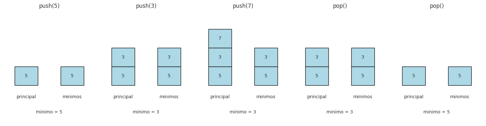

## Ejercicio 3 ★ — Una pila con una operación mínimo en O(1) peor caso

### Enunciado

> Diseña una estructura, enuncia el invariante que la hace correcta y da el costo de cada operación. (C3)

**Modelo.** Word RAM, con la aritmética contada como O(1) sobre palabras de O(log n) bits. El costo se mide en operaciones de pila (push y pop) y comparaciones. Queremos **O(1) en el peor caso** por operación, no amortizado.

### La dificultad

Una pila normal soporta push y pop en O(1). Añadir una operación `mínimo()` que devuelva el mínimo de todos los elementos de la pila es fácil si recorres toda la pila: O(n). Pero queremos O(1) en el peor caso.

**La idea ingenua que falla.** Guardar una variable `min_actual` que se actualice en cada push. Esto funciona para push, pero **no para pop**: si el elemento que se saca era el mínimo, no sabes cuál era el mínimo anterior. Necesitarías recordar todos los mínimos históricos, y eso es exactamente lo que vamos a hacer, pero de forma ordenada.

### La estructura: pila principal + pila de mínimos

Usamos **dos pilas**:

- `principal`: guarda todos los elementos, en el orden normal de una pila.
- `minimos`: guarda los mínimos históricos. Su tope es siempre el mínimo actual de `principal`.

**Operaciones:**

```
class PilaConMinimo:
    def __init__(self):
        self.principal = []
        self.minimos = []

    def push(self, x):
        self.principal.append(x)
        if not self.minimos or x <= self.minimos[-1]:
            self.minimos.append(x)

    def pop(self):
        if not self.principal:
            raise IndexError("pila vacía")
        x = self.principal.pop()
        if x == self.minimos[-1]:
            self.minimos.pop()
        return x

    def minimo(self):
        if not self.minimos:
            raise IndexError("pila vacía")
        return self.minimos[-1]
```

**Observación clave.** `minimos` solo guarda un elemento cuando el nuevo elemento es **menor o igual** que el mínimo actual. Cuando sacamos un elemento de `principal`, si ese elemento es igual al tope de `minimos`, lo sacamos también de `minimos`.

### Correctitud parcial (invariante)

**Invariante.** Después de cada operación, el tope de `minimos` (si `minimos` no está vacía) es el mínimo de todos los elementos de `principal`. Además, `minimos` es no decreciente de abajo hacia arriba, es decir, `minimos[0] ≥ minimos[1] ≥ … ≥ minimos[-1]`.

**Inicialización.** Antes de cualquier operación, ambas pilas están vacías. El invariante se cumple trivialmente: no hay tope de `minimos` que verificar, y la condición de monotonía es vacía. 

**Mantenimiento.** Hay tres operaciones:

- **Push(x).** Si `minimos` está vacía o x ≤ `minimos[-1]`, apilamos x en `minimos`. En caso contrario, no lo apilamos. En ambos casos, el nuevo mínimo de `principal` es min(x, mínimo anterior). Si x ≤ mínimo anterior, el nuevo mínimo es x, y x es el nuevo tope de `minimos`. Si x > mínimo anterior, el nuevo mínimo sigue siendo el anterior, y el tope de `minimos` no cambia. La monotonía se mantiene porque solo apilamos x cuando x ≤ `minimos[-1]`. 

- **Pop().** Sacamos x de `principal`. Si x == `minimos[-1]`, sacamos también el tope de `minimos`. Hay dos casos: si x era el mínimo, al sacarlo el nuevo mínimo es el siguiente tope de `minimos` (que es el mínimo de los elementos restantes, por el invariante anterior). Si x no era el mínimo, el mínimo no cambia, y `minimos` no cambia. La monotonía se mantiene porque solo sacamos el tope. 

- **Mínimo().** Devuelve el tope de `minimos`, que por el invariante es el mínimo de `principal`. 

**Conclusión.** Al terminar cualquier secuencia de operaciones, el invariante se mantiene. En particular, `minimo()` devuelve el mínimo correcto. 

### Terminación

Cada operación (push, pop, mínimo) es una secuencia finita de operaciones atómicas. No hay ciclos. La estructura no tiene bucles, así que la terminación es inmediata. 

### Costo

- **Push:** 1 operación de pila en `principal`, más a lo sumo 1 comparación y a lo sumo 1 operación de pila en `minimos`. Total: **O(1) en el peor caso**.
- **Pop:** 1 operación de pila en `principal`, más a lo sumo 1 comparación y a lo sumo 1 operación de pila en `minimos`. Total: **O(1) en el peor caso**.
- **Mínimo:** 1 acceso al tope de `minimos`. Total: **O(1) en el peor caso**.

**Memoria.** O(n) en el peor caso (cuando los elementos se insertan en orden decreciente, `minimos` guarda todos los elementos). En el caso promedio, `minimos` guarda menos elementos, pero la cota de peor caso es O(n).

**Nota sobre el "peor caso".** A diferencia del análisis amortizado de la Conferencia 4, aquí **cada operación individual** es O(1) en el peor caso. No hay una operación cara que se pague con operaciones baratas anteriores. Esto es importante: si una aplicación necesita que cada operación sea rápida (un sistema de tiempo real, una interfaz que no puede congelarse), esta estructura sirve, mientras que una estructura con O(1) amortizado no necesariamente.

### Código

La implementación con verificación del invariante está en
[`codigos/ejercicio-03.py`](codigos/ejercicio-03.py).

Puntos clave del código:

- `PilaConMinimo` mantiene dos listas: `principal` y `minimos`.
- `push(x)` apila x en `principal` y, solo si x ≤ tope de `minimos`,
  también lo apila en `minimos`.
- `pop()` saca de `principal` y, si el elemento sacado es igual al tope
  de `minimos`, también saca de `minimos`.
- El método `_verificar()` comprueba el invariante después de cada
  operación: el tope de `minimos` es el mínimo de `principal`, y
  `minimos` es no decreciente de abajo hacia arriba.
- El programa imprime una traza de operaciones y corre un test aleatorio
  de 10,000 operaciones.

### Casos de prueba

| Operación | principal | minimos | Resultado |
|-----------|-----------|---------|-----------|
| push(5) | [5] | [5] | — |
| push(3) | [5, 3] | [5, 3] | — |
| push(7) | [5, 3, 7] | [5, 3] | — |
| minimo() | [5, 3, 7] | [5, 3] | 3 |
| pop() | [5, 3] | [5, 3] | 7 |
| minimo() | [5, 3] | [5, 3] | 3 |
| pop() | [5] | [5] | 3 |
| minimo() | [5] | [5] | 5 |
| push(2) | [5, 2] | [5, 2] | — |
| minimo() | [5, 2] | [5, 2] | 2 |
| pop() | [5] | [5] | 2 |
| minimo() | [5] | [5] | 5 |
| pop() | [] | [] | 5 |
| minimo() | [] | [] | error |



**Figura 1.** Evolución de la pila `principal` y la pila `minimos` con
una secuencia de push y pop. Obsérvese que el tope de `minimos` es
siempre el mínimo de `principal`, y que `minimos` solo guarda los
elementos que son mínimos históricos.

**Verificación del invariante.** En cada paso, el tope de `minimos` es el mínimo de `principal`:

- Después de push(5): min([5]) = 5 = tope de minimos. 
- Después de push(3): min([5,3]) = 3 = tope de minimos. 
- Después de push(7): min([5,3,7]) = 3 = tope de minimos. 
- Después de pop() (saca 7): min([5,3]) = 3 = tope de minimos. 
- Después de pop() (saca 3): min([5]) = 5 = tope de minimos. 
- Después de push(2): min([5,2]) = 2 = tope de minimos. 


### Cota mínima

**No aplica** en el sentido de la Conferencia 5, porque no estamos demostrando que ningún algoritmo pueda hacerlo mejor. Pero sí podemos argumentar que **cada operación requiere al menos Ω(1)**:

- Push necesita al menos 1 operación para insertar el elemento.
- Pop necesita al menos 1 operación para sacar el elemento.
- Mínimo necesita al menos 1 acceso para leer el mínimo.

Así que O(1) por operación es **óptimo** en el modelo word RAM.

### Comentario (lo que el profesor valora)

Este ejercicio es un ejemplo de **invariante que se puede ejecutar**. El invariante "el tope de `minimos` es el mínimo de `principal`" se puede verificar en cada paso con un assert. Además, la estructura es un ejemplo de **O(1) en el peor caso**, no amortizado, que es lo que la Conferencia 4 distingue del O(1) amortizado de la cola con dos pilas.

**Conexión con la Conferencia 4.** La cola con dos pilas tiene desencolar O(1) amortizado, pero un desencolar individual puede costar Θ(n). La pila con mínimo tiene **todas** las operaciones O(1) en el peor caso. La diferencia es que en la pila con mínimo no hay una operación que acumule trabajo pendiente: cada push y cada pop hace una cantidad constante de trabajo.

### Conclusión

La pila con mínimo es una estructura que soporta push, pop y mínimo en **O(1) en el peor caso**, usando una pila auxiliar de mínimos históricos. El invariante "el tope de `minimos` es el mínimo de `principal`" da la correctitud, y la estructura no tiene bucles, así que la terminación es inmediata.
