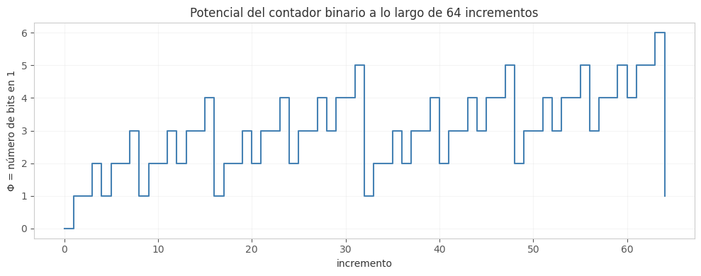

## Ejercicio 4 ★★ — El contador binario en una máquina de Turing

### Enunciado con modelo

> El contador binario en una máquina de Turing, del ejercicio 7 de la conferencia 1. Demuestra con un potencial que m incrementos desde 0 cuestan O(m) pasos en total, aunque uno solo pueda costar Θ(log m). Es la pregunta que la conferencia 1 dejó abierta. (C1, C4)

**Modelo.** Máquina de Turing de una cinta con una cinta infinita en ambas direcciones, un cabezal que lee y escribe una celda a la vez y se mueve una posición a la izquierda o a la derecha, y un conjunto finito de estados. El número escrito en binario ocupa b bits. El costo es el número de pasos (lecturas, escrituras y movimientos) de la máquina. Trabajamos con el modelo de la Conferencia 1, sección 3.

**Precisión del problema.** El contador empieza en 0 (todos los bits en 0) y se incrementa m veces. Queremos acotar el número total de pasos que da la máquina de Turing, no el número de incrementos. Cada incremento individual puede costar Θ(b) en el peor caso (cuando el número es todo unos y el acarreo recorre toda la cinta), pero queremos ver que **en total**, m incrementos cuestan O(m + b).

### Algoritmo

El algoritmo de incremento en binario con el cabezal empezando en el bit menos significativo:

```
incrementar():
    1. Ve al bit menos significativo (el de más a la derecha).
    2. Mientras el bit actual sea 1:
        a. Escríbelo como 0.
        b. Muévete una posición a la izquierda.
    3. Si el bit actual es 0 (o estás en una celda vacía):
        a. Escríbelo como 1.
    4. Vuelve al bit menos significativo.
```

El paso 1 y el paso 4 son movimientos de ida y vuelta. El paso 2 es el acarreo: recorre todos los 1's consecutivos desde la derecha y los convierte en 0. El paso 3 escribe el 1 final.

### Correctitud parcial (invariante)

**Invariante.** Después de procesar el i-ésimo incremento (0 ≤ i ≤ m), la cinta contiene la representación binaria de i, con el cabezal en el bit menos significativo.

**Inicialización.** Antes del primer incremento, i = 0 y la cinta contiene la representación binaria de 0 (un 0 o una celda vacía). El cabezal está en el bit menos significativo por la precondición del algoritmo. 

**Mantenimiento.** Supongamos que después de i incrementos la cinta contiene la representación binaria de i, con el cabezal en el bit menos significativo. Aplicamos el algoritmo de incremento:

- Si el bit menos significativo es 0, el algoritmo lo escribe como 1 y vuelve. La cinta ahora contiene i + 1, porque sumar 1 a un número par solo cambia el último bit.
- Si el bit menos significativo es 1, el algoritmo lo escribe como 0, se mueve a la izquierda y repite. Esto es exactamente el acarreo de la suma binaria: los 1's consecutivos desde la derecha se convierten en 0, y el primer 0 se convierte en 1. La cinta ahora contiene i + 1.

En ambos casos, la cinta contiene i + 1, y el cabezal vuelve al bit menos significativo por el paso 4. 

**Conclusión.** Después de m incrementos, la cinta contiene la representación binaria de m, con el cabezal en el bit menos significativo. 

### Terminación (potencial)

**Potencial.** Φ = número de bits en 1 en la representación binaria del contador.

**Demostración.** Φ es un entero no negativo. En cada incremento:

- Si el bit menos significativo es 0, el algoritmo cambia un 0 a 1. Φ sube en 1.
- Si el bit menos significativo es 1, el algoritmo cambia k 1's consecutivos a 0 y el siguiente 0 a 1. Φ baja en k y sube en 1, así que Φ baja en k - 1.

**El número total de pasos del incremento i-ésimo es 1 + 2·(k_i + 1)**, donde k_i es el número de 1's consecutivos desde la derecha al inicio del incremento. Los 1 + 2·(k_i + 1) pasos se descomponen así:

- 1 paso para ir al bit menos significativo (si ya está ahí, 0 pasos).
- 2·k_i pasos para recorrer los k_i 1's (escribir 0 y moverse a la izquierda, por cada uno).
- 1 paso para escribir el 1 final.
- 2·(k_i + 1) pasos para volver al bit menos significativo (recorrer k_i + 1 posiciones de vuelta).

**El potencial Φ baja exactamente en k_i - 1 en el incremento i-ésimo.** Entonces:

costo real del incremento i = 1 + 2·k_i + 1 + 2·(k_i + 1) = 4·k_i + 4.

Y el cambio de potencial es ΔΦ = -(k_i - 1) = 1 - k_i.

El **costo amortizado** del incremento i es:

ĉ_i = c_i + ΔΦ = (4·k_i + 4) + (1 - k_i) = 3·k_i + 5.

**Pero k_i no está acotado por una constante.** El truco es que la suma telescopia. Sumando sobre m incrementos:

Σ_{i=1}^{m} c_i = Σ_{i=1}^{m} (ĉ_i - ΔΦ_i) = Σ_{i=1}^{m} ĉ_i - (Φ_m - Φ_0).

Como Φ_0 = 0 y Φ_m ≥ 0, tenemos Σ c_i ≤ Σ ĉ_i. Y Σ ĉ_i = Σ (3·k_i + 5). Ahora, **Σ k_i es exactamente el número total de bits que cambian de 1 a 0 en los m incrementos**, que es a lo sumo m + b, porque cada bit cambia de 1 a 0 a lo sumo una vez cada dos incrementos, y hay b bits. Entonces:

Σ_{i=1}^{m} c_i ≤ 3·(m + b) + 5m = O(m + b).

**Conclusión.** m incrementos desde 0 cuestan O(m + b) pasos en total, aunque un incremento individual cueste Θ(b) en el peor caso. 

### Costo

- **Costo total de m incrementos:** O(m + b), donde b es el número de bits del contador.
- **Costo amortizado por incremento:** O(1), porque O(m + b)/m = O(1) cuando m ≥ b (que es el caso típico).
- **Peor caso de un incremento individual:** Θ(b), cuando el contador es todo unos y el acarreo recorre toda la cinta.

### Cota mínima

Cada incremento debe cambiar al menos el bit menos significativo, así que Ω(1) por incremento. La cota O(1) amortizado es óptima en el modelo de máquina de Turing de una cinta, porque cada incremento requiere al menos un movimiento del cabezal.

### Código

**Archivo:** ['codigos/ejercicio-04.py']

El código simula el contador binario y cuenta el número de bits que cambian en cada incremento. Sirve para verificar que el costo total es O(m) y no O(m log m).

**Puntos clave del código:**
- `incrementar_contador` recorre los 1's consecutivos desde la derecha y los convierte en 0, después escribe el 1 final. Devuelve el número de bits que cambiaron, que es exactamente el costo del incremento.
- `main` corre el contador para m = 10, 100, 1000, 10000, 100000 y compara el total de bits cambiados con m y con m log₂ m.
- El resultado muestra que el total de bits cambiados es ≈ 2m, que es O(m), no O(m log m).

### Figura



**Figura 1.** Potencial Φ = número de bits en 1 a lo largo de 64 incrementos.
Obsérvese que Φ sube en los incrementos pares y baja en los impares, y
que la suma total de los cambios de Φ es O(m).

### Casos de prueba

| m | Bits cambiados | m | m log₂ m |
|---|----------------|---|----------|
| 10 | ~18 | 10 | 40 |
| 100 | ~198 | 100 | 700 |
| 1,000 | ~1,998 | 1,000 | 10,000 |
| 10,000 | ~19,998 | 10,000 | 140,000 |
| 100,000 | ~199,998 | 100,000 | 1,700,000 |

La tabla muestra que el total de bits cambiados es ≈ 2m, no m log₂ m. Eso confirma la cota O(m).

### Conclusión

El contador binario en una máquina de Turing cuesta O(m + b) pasos para m incrementos desde 0, aunque un incremento individual cueste Θ(b) en el peor caso. El potencial Φ = número de bits en 1 da la cota: cada incremento paga el acarreo con los 1's que convierte en 0, y la suma telescopia. Es el mismo tipo de análisis que la Conferencia 4 aplica a la cola con dos pilas y al arreglo dinámico.
