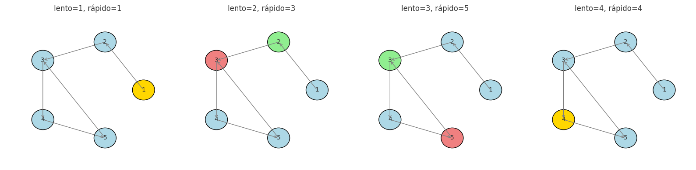

## Ejercicio 5 ★★ — Detección de ciclos en una lista enlazada con dos punteros (algoritmo de Floyd)

### Enunciado con modelo

> Detección de ciclos en una lista enlazada con dos punteros que avanzan a velocidades 1 y 2 (algoritmo de Floyd). Demuestra que se encuentran si y solo si hay un ciclo, con un invariante, y que termina, con un potencial. Da el costo. (C3)

**Modelo.** Modelo de punteros. La lista enlazada tiene n nodos, cada uno con un campo `siguiente` que apunta al siguiente nodo o a `None`. El costo se mide en número de pasos de puntero (avanzar un puntero a `siguiente`). Trabajamos con el modelo de la Conferencia 3, sección 1.

**Precisión del problema.** Dada una lista enlazada, decidir si tiene un ciclo (es decir, si algún nodo es alcanzable desde sí mismo siguiendo los punteros `siguiente`). El algoritmo de Floyd usa dos punteros: `lento` avanza 1 paso por vuelta, `rápido` avanza 2 pasos por vuelta.

### Algoritmo

```
def tiene_ciclo(cabeza):
    lento = cabeza
    rápido = cabeza
    while rápido is not None and rápido.siguiente is not None:
        lento = lento.siguiente
        rápido = rápido.siguiente.siguiente
        if lento is rápido:
            return True
    return False
```

### Correctitud parcial (invariante)

**Invariante.** En cada vuelta del ciclo, si hay un ciclo, los punteros `lento` y `rápido` están ambos dentro del ciclo, y la distancia (en pasos de `lento`) entre ellos a lo largo del ciclo disminuye en 1 en cada vuelta.

**Inicialización.** Antes de la primera vuelta, `lento = rápido = cabeza`. Si hay un ciclo, ambos están en el ciclo (en la cabeza, que es parte del ciclo si el ciclo empieza en la cabeza). La distancia entre ellos es 0. 

**Mantenimiento.** Supongamos que en la vuelta i, `lento` y `rápido` están ambos dentro del ciclo, y la distancia de `lento` a `rápido` a lo largo del ciclo (en la dirección de avance) es d. En la vuelta i+1:

- `lento` avanza 1 paso.
- `rápido` avanza 2 pasos.

La nueva distancia de `lento` a `rápido` a lo largo del ciclo es (d - 1) mod L, donde L es la longitud del ciclo. Si d = 0, los punteros se encuentran y el algoritmo devuelve `True`. Si d > 0, la nueva distancia es d - 1. Así que la distancia baja en 1 en cada vuelta (salvo cuando llega a 0 y se encuentran). 

**Conclusión.** Si hay un ciclo, la distancia entre `lento` y `rápido` baja en 1 en cada vuelta hasta llegar a 0. Cuando llega a 0, los punteros se encuentran y el algoritmo devuelve `True`. Si no hay ciclo, `rápido` llega a `None` (o a un nodo cuyo `siguiente` es `None`) y el algoritmo devuelve `False`. 

### Terminación (potencial)

**Potencial.** Si hay ciclo, Φ = la distancia de `lento` a `rápido` a lo largo del ciclo. Si no hay ciclo, Φ = el número de nodos que le quedan por recorrer a `rápido` hasta `None`.

**Demostración.** En ambos casos, Φ es un entero no negativo. En cada vuelta:

- Si hay ciclo, Φ baja en 1 (o el algoritmo termina cuando Φ = 0).
- Si no hay ciclo, `rápido` avanza 2 pasos, así que Φ baja en 2 (o el algoritmo termina cuando Φ ≤ 1).

En ambos casos, Φ baja estrictamente en cada vuelta. Como Φ es un entero no negativo, no puede bajar indefinidamente: el ciclo termina. 

### Costo

- **Sin ciclo:** `rápido` recorre la lista en n/2 vueltas (porque avanza 2 pasos por vuelta). Costo: **O(n)** pasos de puntero.
- **Con ciclo:** el algoritmo entra al ciclo después de a lo sumo n pasos, y después la distancia entre los punteros baja en 1 por vuelta. La distancia inicial es a lo sumo L (la longitud del ciclo). Costo total: **O(n + L) = O(n)** pasos de puntero.
- **Memoria:** O(1), solo dos punteros.

### Cota mínima

Cualquier algoritmo que decida si hay un ciclo debe leer al menos los n nodos, porque si no lee un nodo, no puede saber si su `siguiente` cierra un ciclo. Así que Ω(n) pasos. El algoritmo de Floyd es óptimo en el modelo de punteros.

### Código

**Archivo:** [codigo/ejercicio-05.py]

El código implementa el algoritmo de Floyd y verifica contra un oráculo que usa un conjunto de nodos visitados.



**Figura 1.** El algoritmo de Floyd sobre una lista con ciclo en el nodo 3.
El puntero lento (verde) avanza 1 paso por vuelta, el rápido (rojo) avanza 2.
En la cuarta vuelta se encuentran en el nodo 4.

### Casos de prueba

| Caso | Lista | Resultado | Oráculo |
|------|-------|-----------|---------|
| Sin ciclo | 1 → 2 → 3 → None | False | False |
| Ciclo al final | 1 → 2 → 3 → 2 | True | True |
| Ciclo a sí mismo | 1 → 1 | True | True |
| Lista vacía | None | False | False |
| Un nodo sin ciclo | 1 → None | False | False |

### Conclusión

El algoritmo de Floyd detecta ciclos en O(n) pasos de puntero y O(1) memoria. El invariante "la distancia entre lento y rápido baja en 1 por vuelta" da la correctitud, y el potencial "distancia entre los punteros" da la terminación. Es óptimo en el modelo de punteros porque cualquier algoritmo debe leer al menos n nodos.
