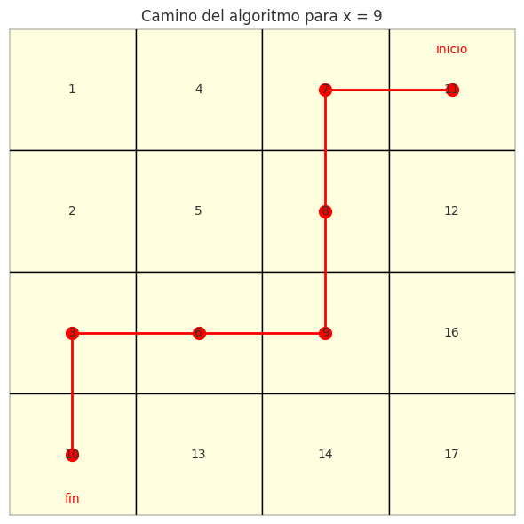

## Ejercicio 6 ★★ — Matriz n × n con filas y columnas ordenadas

### Enunciado con modelo

> Una matriz n × n tiene filas y columnas ordenadas de forma creciente. Diseña un algoritmo que decida si contiene un valor x en O(n) comparaciones, demuestra su correctitud con un invariante, y demuestra con un adversario que no se puede en o(n). (C3, C5)

**Modelo.** Modelo de comparaciones. La matriz A es n × n, con A[i][j] ≤ A[i][j+1] (filas ordenadas) y A[i][j] ≤ A[i+1][j] (columnas ordenadas). El algoritmo solo puede comparar x con elementos de la matriz. El costo es el número de comparaciones. Trabajamos con el modelo de la Conferencia 5, sección 1.

**Precisión del problema.** Decidir si x está en A. La salida es `True` o `False`. La matriz está ordenada en ambas direcciones.

### Algoritmo

El algoritmo empieza en la **esquina superior derecha** y se mueve hacia la izquierda o hacia abajo:

```
def buscar_en_matriz(A, x):
    n = len(A)
    i, j = 0, n - 1  # esquina superior derecha
    while i < n and j >= 0:
        if A[i][j] == x:
            return True
        elif A[i][j] > x:
            j -= 1  # x no puede estar en la columna j
        else:
            i += 1  # x no puede estar en la fila i
    return False
```

### Correctitud parcial (invariante)

**Invariante.** En cada vuelta, si x está en A, está en la submatriz A[i:n][0:j+1] (las filas i a n-1, las columnas 0 a j). Es decir, el algoritmo ha descartado las filas 0 a i-1 y las columnas j+1 a n-1.

**Inicialización.** Antes de la primera vuelta, i = 0 y j = n-1. La submatriz A[0:n][0:n] es la matriz entera, así que si x está, está ahí. 

**Mantenimiento.** Supongamos que el invariante vale antes de una vuelta, es decir, si x está, está en A[i:n][0:j+1]. Sea v = A[i][j]:

- Si v == x, el algoritmo devuelve `True`. La postcondición se cumple.
- Si v > x, entonces x no puede estar en la columna j, porque todos los elementos de A[0:i+1][j] son ≤ v (por el orden de las columnas), así que todos son ≤ v, y si v > x, ninguno es x. El algoritmo hace j -= 1, y el nuevo rango es A[i:n][0:j], que contiene a x si x está. 
- Si v < x, entonces x no puede estar en la fila i, porque todos los elementos de A[i][0:j+1] son ≤ v (por el orden de las filas), así que todos son ≤ v, y si v < x, ninguno es x. El algoritmo hace i += 1, y el nuevo rango es A[i+1:n][0:j+1], que contiene a x si x está. 

**Conclusión.** Al terminar, i = n o j = -1. La submatriz A[i:n][0:j+1] es vacía. Por el invariante, si x estuviera en A, estaría en una submatriz vacía, lo cual es imposible. Por lo tanto, x no está en A. El algoritmo devuelve `False`. 

### Terminación (potencial)

**Potencial.** Φ = (n - i) + (j + 1), el número de filas y columnas que todavía no se han descartado.

**Demostración.** Φ es un entero no negativo. En cada vuelta:

- Si v == x, el algoritmo termina.
- Si v > x, j baja en 1, así que Φ baja en 1.
- Si v < x, i sube en 1, así que Φ baja en 1.

En todos los casos, Φ baja estrictamente en cada vuelta (o el algoritmo termina). Como Φ es un entero no negativo, no puede bajar indefinidamente: el ciclo termina después de a lo sumo 2n - 1 vueltas. 

### Costo

- **Peor caso:** 2n - 1 comparaciones (el camino más largo desde la esquina superior derecha hasta la inferior izquierda).
- **Mejor caso:** 1 comparación (si x está en la esquina superior derecha).
- **Memoria:** O(1).

### Cota mínima (adversario)

**Teorema.** Decidir si x está en una matriz n × n con filas y columnas ordenadas requiere al menos n comparaciones en el peor caso.

**Demostración (adversario).** El adversario mantiene un conjunto de celdas que todavía podrían contener x. Inicialmente, todas las celdas. Cuando el algoritmo compara x con A[i][j], el adversario responde de forma consistente con dos matrices distintas: una donde x está en A[i][j] y otra donde no está. Para que el algoritmo se equivoque, el adversario debe mantener dos matrices consistentes con todas las respuestas hasta que el algoritmo termine.

**La construcción del adversario.** El adversario elige una **diagonal** de la matriz: las celdas (0, n-1), (1, n-2), ..., (n-1, 0). Hay n celdas en esta diagonal. Para cada celda (i, j) de la diagonal, el adversario puede elegir un valor v_ij tal que v_ij < x para las celdas a la izquierda de la diagonal y v_ij > x para las celdas a la derecha. La matriz está ordenada si los valores de la diagonal son crecientes de arriba-izquierda a abajo-derecha (o decrecientes, dependiendo de la orientación).

**El argumento.** Si el algoritmo no compara x con alguna celda de la diagonal, el adversario puede elegir el valor de esa celda para que x esté o no esté, sin contradecir ninguna respuesta. Así que el algoritmo debe comparar al menos n celdas de la diagonal. Como hay n celdas en la diagonal, el algoritmo debe hacer al menos n comparaciones. **No se puede en o(n).** 

**Nota:** la cota es Ω(n), no Ω(n log n). El algoritmo de la esquina superior derecha hace 2n - 1 comparaciones, que es O(n). La cota es ajustada salvo por el factor 2.

### Código

**Archivo:** [codigos/ejercicio-06.py]

El código implementa el algoritmo y verifica contra un oráculo que recorre toda la matriz.

**Puntos clave del código:**
- `buscar_en_matriz` empieza en la esquina superior derecha y se mueve izquierda o abajo.
- `oraculo` recorre toda la matriz, que es O(n²), para verificar.
- Los casos de prueba incluyen todos los elementos de la matriz y algunos que no están (0, 15, 18, 100).



**Figura 1.** Camino del algoritmo desde la esquina superior derecha.
En cada paso, el algoritmo descarta una fila (si A[i][j] < x) o una
columna (si A[i][j] > x). El camino tiene a lo sumo 2n - 1 pasos.

Casos de prueba

| x | Algoritmo | Oráculo |
|---|-----------|---------|
| 1 | True | True |
| 9 | True | True |
| 17 | True | True |
| 0 | False | False |
| 15 | False | False |
| 100 | False | False |

### Conclusión

El algoritmo de la esquina superior derecha decide si x está en la matriz en O(n) comparaciones. El invariante "x está en A[i:n][0:j+1]" da la correctitud, y el potencial Φ = (n-i) + (j+1) da la terminación. La cota mínima Ω(n) por adversario demuestra que no se puede hacer en o(n), así que el algoritmo es óptimo salvo por el factor 2.

