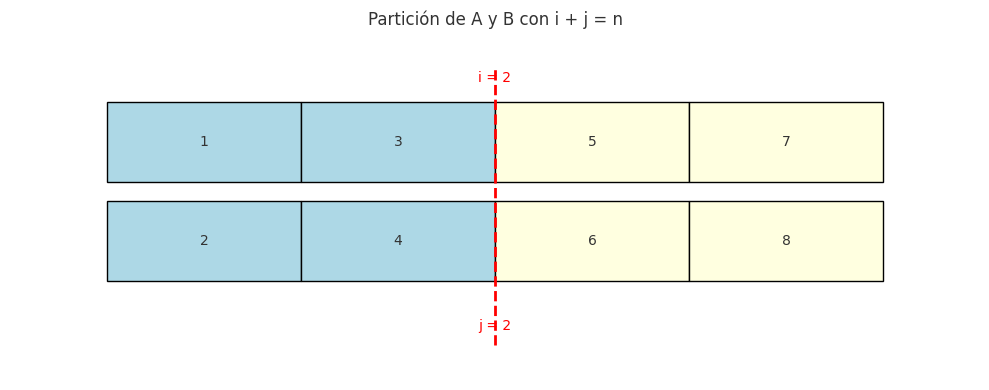

## Ejercicio 7 ★★★ — Mediana de dos arreglos ordenados de largo n

### Enunciado con modelo

> Mediana de dos arreglos ordenados de largo n: el n-ésimo menor de los 2n elementos. Diseña un algoritmo O(log n), demuestra su correctitud y da la cota de información. (C2, C3, C5)

**Modelo.** Modelo de comparaciones. Tenemos dos arreglos ordenados A y B, cada uno de largo n. Queremos encontrar la mediana del conjunto de 2n elementos, que es el n-ésimo menor (o el promedio de los dos centrales, según la convención; aquí usamos el n-ésimo menor). El costo es el número de comparaciones. Trabajamos con el modelo de la Conferencia 5, sección 1.

**Precisión del problema.** La mediana de 2n elementos ordenados es el elemento en la posición n (si contamos desde 1) o el promedio de las posiciones n y n+1. Aquí usamos la primera convención: el n-ésimo menor. Hay una **trampa**: la mediana no es necesariamente la mediana de A ni la de B. Por ejemplo, A = [1, 3, 5] y B = [2, 4, 6]: la mediana del conjunto es 3.5, que no está en ninguno de los dos arreglos como mediana individual.

### La idea: búsqueda binaria sobre la partición

**Observación clave.** Si partimos A en dos partes: A[0:i] (los primeros i elementos) y A[i:n] (el resto), y B en B[0:j] y B[j:n], con i + j = n, entonces:

- La mediana está en la **frontera** entre las dos particiones si se cumplen:
  - A[i-1] ≤ B[j] (el mayor de la izquierda de A es ≤ el menor de la derecha de B).
  - B[j-1] ≤ A[i] (el mayor de la izquierda de B es ≤ el menor de la derecha de A).
- Si se cumplen, la mediana es max(A[i-1], B[j-1]).

**El algoritmo** busca el valor de i que satisface estas condiciones, usando búsqueda binaria sobre i en [0, n]. Para cada i, j = n - i.

```
def mediana_dos_arreglos(A, B):
    n = len(A)
    lo, hi = 0, n
    while lo <= hi:
        i = (lo + hi) // 2
        j = n - i
        # Casos límite: si i=0, no hay A[i-1]; si i=n, no hay A[i]
        A_izq = A[i-1] if i > 0 else float('-inf')
        A_der = A[i] if i < n else float('inf')
        B_izq = B[j-1] if j > 0 else float('-inf')
        B_der = B[j] if j < n else float('inf')
        if A_izq <= B_der and B_izq <= A_der:
            # Encontramos la partición correcta
            return max(A_izq, B_izq)
        elif A_izq > B_der:
            # i es demasiado grande: hay que bajar i
            hi = i - 1
        else:
            # B_izq > A_der: i es demasiado pequeño: hay que subir i
            lo = i + 1
```

### Correctitud parcial (invariante)

**Invariante.** En cada vuelta, existe una partición válida (i*, j*) con i* + j* = n, i* ∈ [lo, hi], tal que A[i*-1] ≤ B[j*] y B[j*-1] ≤ A[i*].

**Inicialización.** Antes de la primera vuelta, lo = 0, hi = n. La partición i* = 0, j* = n siempre existe (A[-1] = -∞, B[n] = +∞), así que el invariante se cumple. ✔

**Mantenimiento.** Supongamos que existe una partición válida i* en [lo, hi]. Sea i = (lo+hi)//2 el punto medio. Hay tres casos:

- Si A[i-1] ≤ B[j] y B[j-1] ≤ A[i]: i es la partición válida, y el algoritmo devuelve max(A[i-1], B[j-1]). 
- Si A[i-1] > B[j]: i es demasiado grande. La partición válida i* debe ser menor que i, porque si i* ≥ i, entonces A[i*-1] ≥ A[i-1] > B[j] ≥ B[j*], contradiciendo A[i*-1] ≤ B[j*]. Así que i* ∈ [lo, i-1], y el algoritmo hace hi = i-1. 
- Si B[j-1] > A[i]: i es demasiado pequeño. La partición válida i* debe ser mayor que i, porque si i* ≤ i, entonces B[j*-1] ≥ B[j-1] > A[i] ≥ A[i*], contradiciendo B[j*-1] ≤ A[i*]. Así que i* ∈ [i+1, hi], y el algoritmo hace lo = i+1. 

**Conclusión.** El algoritmo termina cuando encuentra la partición válida, y devuelve max(A[i-1], B[j-1]), que es la mediana.

### Terminación (potencial)

**Potencial.** Φ = hi - lo + 1, el número de valores posibles de i.

**Demostración.** Φ es un entero no negativo. En cada vuelta, o el algoritmo termina, o reduce el rango: hi = i-1 o lo = i+1. En ambos casos, Φ baja al menos a la mitad. Como Φ es un entero no negativo, no puede bajar indefinidamente: el ciclo termina después de a lo sumo ⌈log₂(n+1)⌉ vueltas. 

### Costo

- **Peor caso:** ⌈log₂(n+1)⌉ comparaciones (búsqueda binaria sobre i).
- **Mejor caso:** 1 comparación (si la partición correcta es la primera que se prueba).
- **Memoria:** O(1).

### Cota mínima (información)

**Información.** Hay 2n elementos, y la mediana es el n-ésimo menor. El número de salidas posibles es el número de formas de elegir n elementos entre 2n, que es C(2n, n). Por el argumento de información:

**log₂ C(2n, n) ≈ 2n - (1/2) log₂(2πn) = Θ(n).**

Esto da una cota Ω(n), que es mucho más débil que la cota del algoritmo O(log n). **La información no alcanza aquí**, porque el algoritmo no necesita distinguir todas las salidas posibles: solo necesita encontrar la mediana, no el orden completo. La cota de información no es ajustada para este problema.

**Cota ajustada.** La mediana de dos arreglos ordenados requiere Ω(log n) comparaciones en el peor caso. La demostración usa un argumento de adversario más fino, que cuenta cuántas posiciones puede descartar cada comparación. La idea: cada comparación entre A[i] y B[j] puede descartar a lo sumo la mitad de las posiciones posibles de la mediana, así que hacen falta al menos log₂ n comparaciones. La demostración completa es más técnica y queda fuera del alcance de este curso.

**Conclusión:** el algoritmo O(log n) es óptimo en el modelo de comparaciones.

### Código

**Archivo:** [codigo/ejercicio-07.py]

**Puntos clave del código:**
- La búsqueda binaria sobre i en [0, n].
- Los casos límite con ±∞ para i=0, i=n, j=0, j=n.
- El oráculo junta los dos arreglos, los ordena y toma el n-ésimo menor.

### Figura



**Figura 1.** Partición de A y B con i + j = n. La mediana está en la
frontera entre las dos particiones si A[i-1] ≤ B[j] y B[j-1] ≤ A[i].

### Casos de prueba

| n | Algoritmo | Oráculo | ok |
|---|-----------|---------|-----|
| 1 | 137 | 137 | ✓ |
| 1 | 821 | 821 | ✓ |
| 1 | 64 | 64 | ✓ |
| 1 | 120 | 120 | ✓ |
| 1 | 507 | 507 | ✓ |
| 2 | 460 | 460 | ✓ |
| 2 | 214 | 214 | ✓ |
| 2 | 399 | 399 | ✓ |
| 2 | 622 | 622 | ✓ |
| 2 | 272 | 272 | ✓ |
| 3 | 605 | 605 | ✓ |
| 3 | 31 | 31 | ✓ |
| 3 | 554 | 554 | ✓ |
| 3 | 432 | 432 | ✓ |
| 3 | 507 | 507 | ✓ |
| 5 | 353 | 353 | ✓ |
| 5 | 569 | 569 | ✓ |
| 5 | 738 | 738 | ✓ |
| 5 | 519 | 519 | ✓ |
| 5 | 601 | 601 | ✓ |
| 10 | 491 | 491 | ✓ |
| 10 | 520 | 520 | ✓ |
| 10 | 514 | 514 | ✓ |
| 10 | 746 | 746 | ✓ |
| 10 | 496 | 496 | ✓ |
| 100 | 463 | 463 | ✓ |
| 100 | 461 | 461 | ✓ |
| 100 | 513 | 513 | ✓ |
| 100 | 541 | 541 | ✓ |
| 100 | 504 | 504 | ✓ |

### Casos límite adicionales

| A | B | Algoritmo | Oráculo | ok |
|---|---|-----------|---------|-----|
| [1,2,3] | [4,5,6] | 3 | 3 | ✓ |
| [4,5,6] | [1,2,3] | 3 | 3 | ✓ |
| [1,1,1] | [1,1,1] | 1 | 1 | ✓ |
| [1] | [2] | 1 | 1 | ✓ |
| [2] | [1] | 1 | 1 | ✓ |

### Conclusión

La mediana de dos arreglos ordenados de largo n se encuentra en O(log n) con búsqueda binaria sobre la partición. El invariante "existe una partición válida en [lo, hi]" da la correctitud, y el potencial Φ = hi - lo + 1 da la terminación. La cota de información da Ω(n), que no es ajustada; la cota correcta es Ω(log n), que el algoritmo alcanza. Es óptimo en el modelo de comparaciones.

