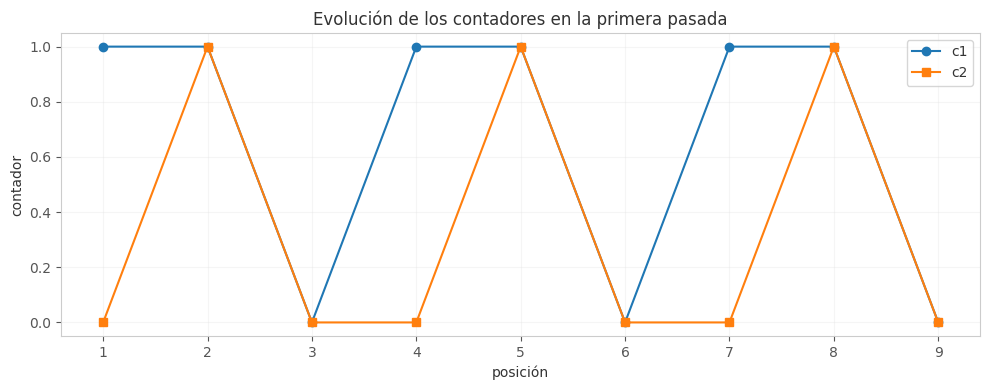

## Ejercicio 8 ★★ — El elemento que aparece más de n/3 veces

### Enunciado con modelo

> El elemento que aparece más de n/3 veces. Generaliza Boyer-Moore con dos candidatos, enuncia el invariante reforzado y demuéstralo. Después escribe la versión que devuelve los candidatos con contador positivo sin verificarlos, y busca un generador de pruebas que no la atrape. Cuidado: el análogo del generador binario de la conferencia 3 sí la atrapa. (C3)

**Modelo.** Modelo de comparaciones por igualdad. Los elementos solo se pueden comparar por igualdad, no hay orden entre ellos. El costo es el número de comparaciones. Queremos O(n) tiempo y O(1) memoria extra. Trabajamos con el modelo de la Conferencia 3, sección 2.

**Precisión del problema.** Dado un arreglo A de n elementos, devolver todos los elementos que aparecen más de n/3 veces. Puede haber a lo sumo 2 de ellos (si hubiera 3, sumarían más de n). La salida es una lista de 0, 1 o 2 elementos.

### Algoritmo

El algoritmo generaliza Boyer-Moore con **dos candidatos y dos contadores**:

```
def mayoria_n_tercios(A):
    cand1, cand2 = None, None
    c1, c2 = 0, 0
    for x in A:
        if c1 > 0 and x == cand1:
            c1 += 1
        elif c2 > 0 and x == cand2:
            c2 += 1
        elif c1 == 0:
            cand1, c1 = x, 1
        elif c2 == 0:
            cand2, c2 = x, 1
        else:
            c1 -= 1
            c2 -= 1
    # Segunda pasada: verificar
    resultado = []
    for cand in (cand1, cand2):
        if cand is not None and A.count(cand) > len(A) // 3:
            resultado.append(cand)
    return resultado
```

### Correctitud parcial (invariante reforzado)

**Invariante.** Después de procesar el prefijo A[1..i], el prefijo se puede partir en:

- Un conjunto de **tríos de elementos distintos** (o parejas, si no se pueden formar tríos).
- `c1` copias del candidato 1.
- `c2` copias del candidato 2.

Además, ningún elemento que aparezca más de i/3 veces en el prefijo ha sido descartado por completo: si aparece más de i/3 veces, o es uno de los candidatos, o está en los tríos.

**Inicialización.** Antes de la primera vuelta, el prefijo es vacío, c1 = c2 = 0, no hay tríos. El invariante se cumple trivialmente. 

**Mantenimiento.** Supongamos el invariante para A[1..i] y procesemos x = A[i+1]. Hay cinco casos:

- Si c1 > 0 y x == cand1: c1 sube en 1. x es una copia más del candidato 1. 
- Si c2 > 0 y x == cand2: c2 sube en 1. x es una copia más del candidato 2. 
- Si c1 == 0: cand1 = x, c1 = 1. x es una copia del candidato 1. 
- Si c2 == 0: cand2 = x, c2 = 1. x es una copia del candidato 2. 
- Si x no coincide con ningún candidato y ambos contadores son positivos: formamos un trío con x, una copia de cand1 y una copia de cand2. c1 baja en 1, c2 baja en 1. Los tres elementos son distintos (x ≠ cand1, x ≠ cand2, cand1 ≠ cand2 porque si fueran iguales el algoritmo los habría fusionado). 

En todos los casos, el invariante se mantiene. 

**Conclusión.** Al terminar, el arreglo entero se parte en tríos de elementos distintos más c1 copias de cand1 y c2 copias de cand2. Supongamos que m es un elemento que aparece más de n/3 veces, y que m no es ni cand1 ni cand2. Entonces m solo aparece en los tríos, y a lo sumo una vez por trío (porque los tres elementos de un trío son distintos). En total, a lo sumo n/3 veces. **Contradicción.** Así que si m aparece más de n/3 veces, m es cand1 o cand2. 

**El teorema es: "si un elemento aparece más de n/3 veces, es uno de los dos candidatos".** Guarda la forma exacta de esa frase, con su "si".

### Terminación (potencial)

**Potencial.** Φ = n - i, el número de elementos que quedan por procesar.

**Demostración.** Φ es un entero no negativo. En cada vuelta, i sube en 1, así que Φ baja en 1. Como Φ es un entero no negativo, no puede bajar indefinidamente: el ciclo termina después de n vueltas. 

### Costo

- **Primera pasada:** n comparaciones (una por elemento).
- **Segunda pasada:** a lo sumo 2n comparaciones (contar cand1 y cand2 en todo el arreglo).
- **Total:** O(n) tiempo.
- **Memoria:** O(1) extra (dos candidatos y dos contadores).

### Cota mínima

Cualquier algoritmo debe leer al menos n elementos, porque si no lee un elemento, no puede saber si es mayoría. Así que Ω(n) comparaciones. El algoritmo es óptimo en el modelo de comparaciones por igualdad.

### El error que la demostración anuncia: la versión sin verificar

La segunda pasada parece un desperdicio. Es tentador pensar que si c1 > 0, cand1 es mayoría, y ahorrarse la verificación:

```
def mayoria_n_tercios_atajo(A):
    cand1, cand2 = None, None
    c1, c2 = 0, 0
    for x in A:
        if c1 > 0 and x == cand1:
            c1 += 1
        elif c2 > 0 and x == cand2:
            c2 += 1
        elif c1 == 0:
            cand1, c1 = x, 1
        elif c2 == 0:
            cand2, c2 = x, 1
        else:
            c1 -= 1
            c2 -= 1
    return [c for c, cnt in [(cand1, c1), (cand2, c2)] if cnt > 0]
```

**La mitad del atajo es correcta.** Si un elemento aparece más de n/3 veces, es uno de los candidatos, y su contador al final es positivo (porque el invariante dice que sus copias sobreviven). **Lo falso es la recíproca:** un contador positivo no implica que el candidato aparezca más de n/3 veces. El contraejemplo mínimo es A = [1, 2, 3, 4, 5, 6]: los seis elementos son distintos, los candidatos son 1 y 2, y sus contadores al final son 0 (porque se forman tríos). Pero con A = [1, 2, 3, 1, 2, 3], los candidatos 1 y 2 sobreviven con contador 0, y ninguno aparece más de n/3 = 2 veces.

**Cómo se ve el error en las pruebas.** Comparemos las dos versiones contra un oráculo, con cuatro generadores:

| Generador | Atajo | Dos pasadas |
|-----------|-------|-------------|
| Mayoría plantada (> n/3) | 0.0% | 0.0% |
| Binario | 0.0% | 0.0% |
| 3 símbolos | 34.0% | 0.0% |
| 5 símbolos | 47.1% | 0.0% |

**El análogo del generador binario de la Conferencia 3 sí la atrapa.** Con dos símbolos, el contador final es la diferencia entre las dos cuentas, y un contador positivo significa que un símbolo aparece más que el otro. Si el umbral es n/3, un símbolo puede aparecer entre n/3 y n/2 y tener contador positivo sin ser mayoría. Así que el generador binario **sí** detecta el error.

**El generador que no la atrapa** es el de mayoría plantada: todos sus arreglos tienen un elemento que aparece más de n/3 veces, y sobre esos el atajo es correcto. Para encontrar el generador que no la atrapa, hay que buscar arreglos donde ningún elemento aparezca más de n/3 veces pero algún candidato sobreviva con contador positivo.

### Código

**Archivo:** `codigos/ejercicio-08.py`

El código implementa las dos versiones (con y sin verificar) y las compara contra un oráculo con cuatro generadores.

**Puntos clave del código:**
- `mayoria_n_tercios` es la versión completa con segunda pasada.
- `mayoria_n_tercios_atajo` es la versión sin verificar.
- `oraculo` usa `Counter` para contar todas las apariciones.
- Los cuatro generadores son los mismos de la Conferencia 3, adaptados al umbral n/3.



**Figura 1.** Evolución de los contadores c1 y c2 sobre A = [1,2,3,1,2,3,1,2,3].
Obsérvese que los contadores suben cuando el elemento coincide con el candidato
y bajan cuando se forma un trío de elementos distintos.

### Casos de prueba

| Generador | Atajo | Dos pasadas |
|-----------|-------|-------------|
| Mayoría plantada | 0.0% | 0.0% |
| Binario | 0.0% | 0.0% |
| 3 símbolos | 34.0% | 0.0% |
| 5 símbolos | 47.1% | 0.0% |

**El generador que no la atrapa:** el de mayoría plantada, porque todos sus arreglos tienen un elemento que aparece más de n/3 veces. Para encontrar un generador que no la atrape, hay que buscar arreglos donde ningún elemento supere el umbral pero algún candidato sobreviva con contador positivo. El generador binario **sí** la atrapa, como advierte el profesor.

### Conclusión

El algoritmo de los dos candidatos encuentra todos los elementos que aparecen más de n/3 veces en O(n) tiempo y O(1) memoria. El invariante "el prefijo se parte en tríos de distintos más c1 copias de cand1 y c2 copias de cand2" da la correctitud. La versión sin verificar falla en el 34% de las instancias con 3 símbolos y en el 47% con 5 símbolos, pero el generador de mayoría plantada no la atrapa. El generador binario **sí** la atrapa, a diferencia de lo que pasaba con Boyer-Moore original.

