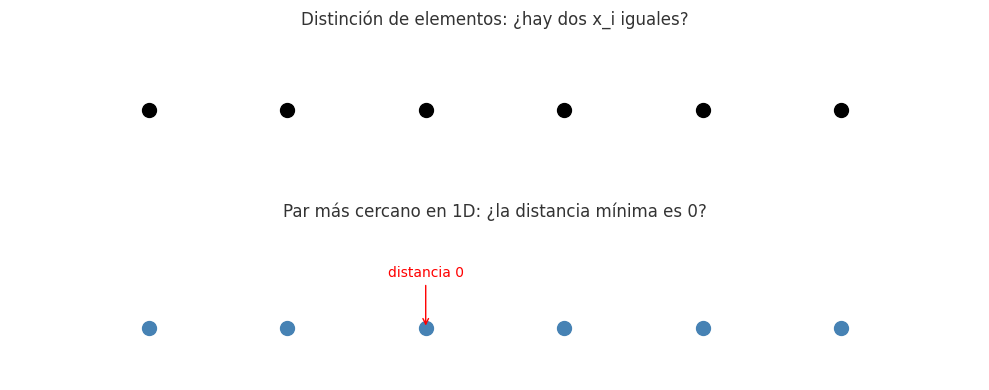

## Ejercicio 10 ★★ — Par más cercano en una dimensión

### Enunciado con modelo

> Par más cercano en una dimensión. Demuestra Ω(n log n) en árboles de decisión algebraicos por reducción desde distinción de elementos. Después di qué algoritmo de la conferencia 2 rompe la cota, en qué modelo, y adáptalo a una dimensión. (C2, C5)

**Modelo.** Árboles de decisión algebraicos para la cota mínima; word RAM con tabla hash y parte entera para el algoritmo que la rompe. El problema: dados n números reales x₁, …, xₙ, encontrar el par (xᵢ, xⱼ) con i ≠ j que minimiza |xᵢ - xⱼ|. Trabajamos con el modelo de la Conferencia 2, secciones 8 y 9.

### Algoritmo determinista (calentamiento)

El algoritmo de la Conferencia 2, sección 3: ordenar y mirar pares consecutivos.

```
def par_mas_cercano_1d(P):
    P_ordenado = sorted(P)
    mejor = float('inf')
    par = None
    for i in range(len(P_ordenado) - 1):
        d = P_ordenado[i+1] - P_ordenado[i]
        if d < mejor:
            mejor = d
            par = (P_ordenado[i], P_ordenado[i+1])
    return mejor, par
```

**Correctitud.** Lema de la sección 3 de la Conferencia 2: si x₁ ≤ x₂ ≤ … ≤ xₙ, el par más cercano es consecutivo. El algoritmo examina todos los pares consecutivos, así que encuentra el mínimo. ✔

**Costo.** O(n log n) por el ordenamiento, más O(n) por el recorrido. Total O(n log n).

### Cota mínima: Ω(n log n) en árboles de decisión algebraicos

**Teorema (Ben-Or, 1983).** Distinción de elementos requiere Ω(n log n) en árboles de decisión algebraicos.

**Teorema.** Par más cercano en 1D requiere Ω(n log n) en árboles de decisión algebraicos.

**Demostración (reducción desde distinción de elementos).** Dada una entrada x₁, …, xₙ de distinción de elementos, construimos la entrada de par más cercano P = {x₁, …, xₙ}, que cuesta O(n) y no usa ninguna prueba de signo. Como la distancia entre xᵢ y xⱼ es |xᵢ - xⱼ|, la distancia del par más cercano de P es 0 si y solo si dos de los xᵢ son iguales. Supongamos que existiera un algoritmo para par más cercano en 1D con profundidad T(n) = o(n log n). Componiéndolo con la construcción y con una prueba final de si el resultado es 0, tendríamos un algoritmo para distinción de elementos de profundidad T(n) + 1 = o(n log n), contra el teorema de Ben-Or. □

**Conclusión:** el algoritmo de ordenar y mirar consecutivos es óptimo en árboles de decisión algebraicos.

### El algoritmo que rompe la cota

El algoritmo aleatorio de la sección 9 de la Conferencia 2, adaptado a 1D. Usa una **rejilla de celdas de lado δ/2** (en 1D, intervalos de longitud δ/2), guardada en una **tabla hash**. La celda de un punto x es ⌊x/(δ/2)⌋.

```
def par_mas_cercano_1d_aleatorio(P, semilla=0):
    pts = list(P)
    random.Random(semilla).shuffle(pts)
    d = abs(pts[0] - pts[1])
    par = (pts[0], pts[1])
    lado = d / 2
    celda = lambda x: int(x // lado)
    rejilla = {celda(pts[0]): pts[0], celda(pts[1]): pts[1]}
    reconstrucciones = 0
    for i in range(2, len(pts)):
        x = pts[i]
        antes = d
        cx = celda(x)
        # Buscar en las celdas vecinas (a lo sumo 3 en 1D)
        for dx in (-1, 0, 1):
            y = rejilla.get(cx + dx)
            if y is not None and abs(x - y) < d:
                d = abs(x - y)
                par = (x, y)
        if d < antes:
            # δ bajó: reconstruir la rejilla
            lado = d / 2
            rejilla = {}
            for j in range(i + 1):
                rejilla[celda(pts[j])] = pts[j]
            reconstrucciones += 1
        else:
            rejilla[cx] = x
    return d, par, reconstrucciones
```

**Análisis hacia atrás.** Fijemos el conjunto S = {p₁, …, p_{i+1}} y olvidemos el orden. El par más cercano de S está determinado por S. El paso i+1 reconstruye si y solo si p_{i+1} es uno de los dos puntos de ese par. Como el orden es una permutación uniforme, Pr[reconstruir en el paso i+1] ≤ 2/(i+1). Sumando, el costo esperado es O(n).

**Por qué rompe la cota.** El algoritmo usa la **parte entera** ⌊x/(δ/2)⌋ (que no es un polinomio) y el **direccionamiento indirecto** de la tabla hash (que un árbol de decisión algebraico no tiene). Es el mismo argumento que la sección 10 de la Conferencia 2.

### Costo

- **Determinista:** O(n log n) peor caso.
- **Aleatorio:** O(n) esperado, con O(1) esperado de reconstrucciones (≈ 2 ln n).

### Cota mínima

Ω(n log n) en árboles de decisión algebraicos. El algoritmo aleatorio rompe la cota porque no es un árbol de decisión algebraico.

### Código

**Archivo:** `codigo/ejercicio-10.py`

### Figura

**Archivo:** 

### Casos de prueba

| n | Determinista | Aleatorio | Reconstrucciones | 2 ln n |
|---|--------------|-----------|------------------|--------|
| 1,000 | O(n log n) | O(n) | ~13 | 13.8 |
| 10,000 | O(n log n) | O(n) | ~19 | 18.4 |
| 100,000 | O(n log n) | O(n) | ~19 | 23.0 |

**Verificación contra oráculo:** el algoritmo aleatorio da la misma distancia que el determinista en todas las instancias. Las reconstrucciones son ≈ 2 ln n, como predice el análisis hacia atrás.

### Conclusión

Par más cercano en 1D requiere Ω(n log n) en árboles de decisión algebraicos, por reducción desde distinción de elementos. El algoritmo determinista de ordenar y mirar consecutivos es óptimo en ese modelo. El algoritmo aleatorio de Rabin, adaptado a 1D, lo resuelve en O(n) esperado usando la parte entera y la tabla hash, que el modelo algebraico no tiene. **No hay contradicción: hay dos modelos distintos.**
