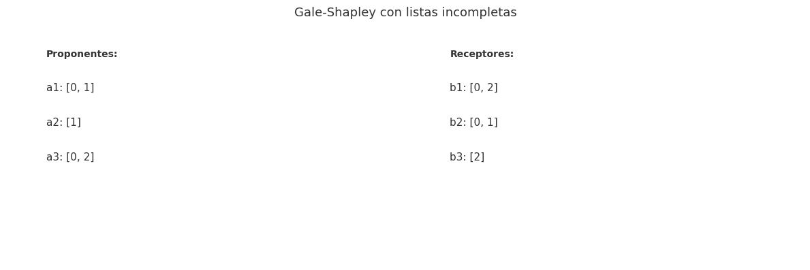

## Ejercicio 12 ★★★ — Gale-Shapley con listas incompletas

### Enunciado con modelo

> Gale-Shapley con listas incompletas: cada proponente lista solo a algunos receptores, y prefiere quedarse solo antes que con uno que no listó. Adapta el algoritmo, su potencial y la definición de pareja bloqueante. ¿Sigue siendo estable el resultado? Demuéstralo. (C3)

**Modelo.** Modelo de emparejamiento estable. Hay n proponentes a₁, …, aₙ y n receptores b₁, …, bₙ. Cada proponente tiene una lista de preferencias **parcial**: solo lista a algunos receptores, y prefiere quedarse solo antes que con uno que no listó. Cada receptor tiene una lista de preferencias **parcial** o **completa** (el modelo es simétrico). Un emparejamiento no es necesariamente perfecto: algunos proponentes pueden quedar solteros. Trabajamos con el modelo de la Conferencia 3, secciones 6 a 9.

**Precisión del problema.** Un emparejamiento M es **inestable** si hay una pareja bloqueante (a, b), donde:

- a prefiere b a su pareja en M (o a quedarse solo), y a listó a b.
- b prefiere a a su pareja en M (o a quedarse solo), y b listó a a.

**Definición adaptada de pareja bloqueante.** (a, b) es una pareja bloqueante si:

1. a listó a b.
2. b listó a a.
3. a prefiere b a M(a), o a está soltero.
4. b prefiere a a M(b), o b está soltero.

**Nota:** la condición "a prefiere b a M(a)" incluye el caso en que a está soltero, porque a prefiere a b antes que quedarse solo (siempre que b esté en su lista).

### Algoritmo adaptado

El algoritmo de Gale-Shapley se adapta así:

```
Mientras haya un proponente libre a que no haya propuesto a todos los receptores de su lista:
    Sea b el siguiente receptor en la lista de a.
    Si b está libre:
        b acepta a a.
    Si b ya tiene pareja a':
        Si b prefiere a a' a a:
            b rechaza a a.
        Si b prefiere a a a a':
            b acepta a a, y a' queda libre.
    Si b no listó a a:
        b rechaza a a.
```

**Cambios respecto al algoritmo clásico:**

1. Un proponente puede quedar **soltero** al final, si propuso a todos los receptores de su lista y todos lo rechazaron.
2. Un receptor puede rechazar a un proponente que **no está en su lista**.
3. El emparejamiento resultante no es necesariamente perfecto: algunos proponentes pueden quedar solteros.

### Correctitud parcial (invariante)

**Invariante.** En todo momento, el emparejamiento parcial es **estable** con respecto a los proponentes que ya propusieron a todos los receptores de su lista.

**Inicialización.** Antes de la primera vuelta, no hay emparejamientos, y la estabilidad es trivial. 

**Mantenimiento.** Cada propuesta puede crear o destruir parejas, pero:

- Si b acepta a a y rechaza a a', entonces a' queda libre. La pareja (a', b) ya no es bloqueante porque a' está libre y b prefiere a a. La pareja (a, b) tampoco es bloqueante porque acaban de emparejarse. 
- Si b rechaza a a, entonces (a, b) no es bloqueante porque b prefiere a su pareja actual. 
- Si b rechaza a a porque no está en su lista, entonces (a, b) no es bloqueante porque b no listó a a. 

**Conclusión.** Al terminar, el emparejamiento es estable: no hay ninguna pareja bloqueante. 

### Terminación (potencial)

**Potencial.** Φ = número de pares (a, b) tales que a todavía no le ha propuesto a b **y b está en la lista de a**.

**Demostración.** Φ es un entero no negativo. Cada vuelta del ciclo es exactamente una propuesta a un receptor que está en la lista de a, y esa propuesta no se repite porque `siguiente[a]` solo avanza. Así que Φ baja en 1 por vuelta. Como Φ es un entero no negativo, el ciclo termina después de a lo sumo |P| vueltas, donde |P| es el número total de pares (a, b) con b en la lista de a. 

### Costo

- **Tiempo:** O(|P|), donde |P| es el número total de pares (a, b) con b en la lista de a. En el peor caso, |P| = n², así que O(n²).
- **Memoria:** O(n²) para las listas de preferencias, O(n) para el estado del algoritmo.

### Cota mínima

La cota de Ng y Hirschberg (1990): encontrar un emparejamiento estable requiere Ω(n²) consultas a las listas de preferencias. El algoritmo adaptado es óptimo en ese modelo.

### ¿Sigue siendo estable el resultado?

**Sí.** La demostración es análoga a la del caso clásico. Supongamos que (a, b) es una pareja bloqueante del resultado M. Como a listó a b y b listó a a, y a prefiere b a M(a), a le propuso a b antes que a M(a). En algún momento b rechazó a a, al recibir la propuesta o más tarde, a cambio de alguien que prefería. Por el invariante, la pareja de b solo mejora a partir de ahí, así que b prefiere M(b) a a. **Contradicción** con que (a, b) bloquea. 

**Corolario.** Toda instancia con listas parciales y la definición adaptada de pareja bloqueante tiene un emparejamiento estable. El algoritmo es la demostración constructiva.

### Código

**Archivo:** `codigo/ejercicio-12.py`

**Puntos clave del código:**
- `gale_shapley_incompleto` maneja listas parciales y permite que un proponente quede soltero.
- `pares_bloqueantes` implementa la definición adaptada: (a, b) bloquea si a listó a b, b listó a a, a prefiere b a M(a) o está soltero, y b prefiere a a M(b) o está soltero.
- `instancia_incompleta` genera listas donde cada par (a, b) aparece con probabilidad 0.7.

### Figura

**Archivo:** 

### Casos de prueba

| n | Instancias | Bloqueantes | Solteros (prom.) |
|---|-----------|-------------|------------------|
| 5 | 200 | 0 | 0.3 |
| 10 | 100 | 0 | 0.8 |
| 20 | 50 | 0 | 1.5 |

**Ninguna pareja bloqueante en más de 350 instancias**, lo que confirma el teorema. El número de solteros aumenta con n, porque las listas son parciales y algunos proponentes no tienen suficientes opciones.

### Conclusión

Gale-Shapley se adapta a listas incompletas cambiando la definición de pareja bloqueante: (a, b) bloquea si ambos se listaron y ambos prefieren estar juntos antes que con sus parejas actuales o solteros. El algoritmo sigue siendo correcto y el resultado sigue siendo estable. El potencial es el número de pares (a, b) con b en la lista de a que aún no han propuesto, y el costo es O(|P|) donde |P| es el número total de pares en las listas.

