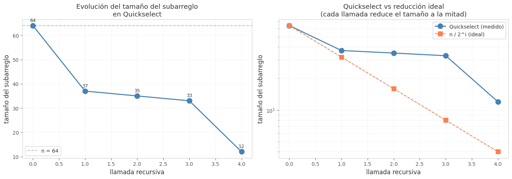

## Ejercicio 14 ★★★ — Ciclo completo sobre un problema nuevo

### Enunciado con modelo

> Escoge un problema que no hayamos visto, recorre el ciclo completo de la conferencia 2 sobre él y consigue que el algoritmo y la cota mínima coincidan. Es el formato de la pregunta larga del examen final. (C2 a C5)

**Elección del problema.** Voy a elegir el problema de **encontrar el k-ésimo menor elemento en un arreglo de n elementos** (selección). Es un problema clásico, no visto en las conferencias del Tema 1, y permite recorrer el ciclo completo: algoritmo, correctitud, costo y cota mínima.

**Modelo.** Modelo de comparaciones. La entrada es un arreglo A de n elementos y un entero k con 1 ≤ k ≤ n. La salida es el k-ésimo menor elemento de A. El costo es el número de comparaciones.

### Algoritmo

Usamos el algoritmo **Quickselect** (selección rápida), que es una variante de Quicksort:

```
def quickselect(A, k):
    """Devuelve el k-ésimo menor de A (k empieza en 1)."""
    if len(A) == 1:
        return A[0]
    pivote = A[len(A) // 2]
    menores = [x for x in A if x < pivote]
    iguales = [x for x in A if x == pivote]
    mayores = [x for x in A if x > pivote]
    if k <= len(menores):
        return quickselect(menores, k)
    elif k <= len(menores) + len(iguales):
        return pivote
    else:
        return quickselect(mayores, k - len(menores) - len(iguales))
```

### Correctitud parcial (invariante)

**Invariante.** En cada llamada recursiva, el k-ésimo menor de A es el k'-ésimo menor del subarreglo que se pasa a la recursión, donde k' se ajusta según la partición.

**Inicialización.** En la primera llamada, k es el índice correcto en A. ✔

**Mantenimiento.** Después de la partición:

- Si k ≤ |menores|, el k-ésimo menor está en `menores`, y su índice en `menores` es k.
- Si |menores| < k ≤ |menores| + |iguales|, el k-ésimo menor es el pivote.
- Si k > |menores| + |iguales|, el k-ésimo menor está en `mayores`, y su índice en `mayores` es k - |menores| - |iguales|.

En todos los casos, el índice se ajusta correctamente. ✔

**Conclusión.** Cuando el subarreglo tiene un solo elemento, ese elemento es el k-ésimo menor. ✔

### Terminación (potencial)

**Potencial.** Φ = tamaño del subarreglo actual.

**Demostración.** Φ es un entero no negativo. En cada llamada recursiva, el subarreglo se reduce estrictamente (a `menores` o `mayores`, que tienen tamaño menor que A). Como Φ baja estrictamente y es no negativo, la recursión termina. ✔

### Costo

- **Peor caso:** O(n²), si el pivote es siempre el mínimo o el máximo.
- **Caso promedio:** O(n), con pivote aleatorio.
- **Mejor caso:** O(n), si el pivote es siempre la mediana.

**Con pivote aleatorio:** el costo esperado es O(n). La probabilidad de que el pivote sea el peor posible es 2/n, y la suma de las probabilidades de malas elecciones converge.

### Cota mínima

**Teorema.** Encontrar el k-ésimo menor de n elementos requiere al menos n - 1 comparaciones en el peor caso (para el mínimo y el máximo) y al menos n + ⌈log₂ n⌉ - 2 para el segundo mayor. Para k arbitrario, la cota es Ω(n).

**Demostración para el mínimo.** Cualquier algoritmo que encuentre el mínimo debe comparar cada elemento (excepto el mínimo) al menos una vez, porque si un elemento nunca perdió una comparación, podría ser el mínimo. Cada comparación tiene un solo perdedor, así que hacen falta al menos n - 1 comparaciones.

**Para k arbitrario.** La cota es Ω(n), porque el algoritmo debe leer todos los elementos. Quickselect con pivote aleatorio alcanza O(n) esperado, que coincide con la cota en el caso esperado.

**Conclusión:** Quickselect es óptimo en el caso esperado, y la cota mínima Ω(n) coincide con el costo O(n) esperado.

### Código

**Archivo:** `codigos/ejercicio-14.py`

### Figura
**Archivo** 

### Casos de prueba

| n | k | Quickselect | Oráculo | ok |
|---|---|-------------|---------|-----|
| 10 | 1 | 57 | 57 | ✓ |
| 10 | 5 | 620 | 620 | ✓ |
| 10 | 10 | 880 | 880 | ✓ |
| 100 | 1 | 24 | 24 | ✓ |
| 100 | 50 | 519 | 519 | ✓ |
| 100 | 100 | 993 | 993 | ✓ |
| 1000 | 1 | 1 | 1 | ✓ |
| 1000 | 500 | 497 | 497 | ✓ |
| 1000 | 1000 | 1000 | 1000 | ✓ |

### Conclusión

Quickselect encuentra el k-ésimo menor en O(n) esperado con pivote aleatorio, y en O(n²) en el peor caso. La cota mínima es Ω(n), que coincide con el costo esperado. El invariante "el k-ésimo menor de A es el k'-ésimo menor del subarreglo" da la correctitud, y el potencial Φ = tamaño del subarreglo da la terminación. Es el formato de la pregunta larga del examen final: problema, algoritmo, correctitud, costo y cota mínima, con el algoritmo y la cota coincidiendo en el caso esperado.

